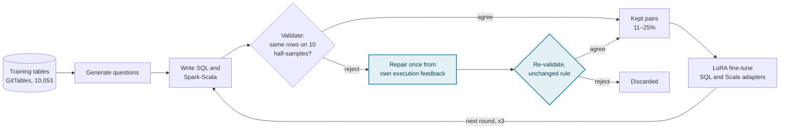
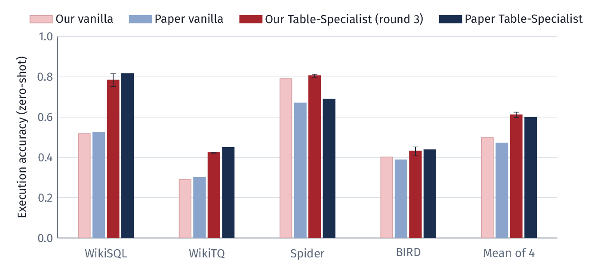
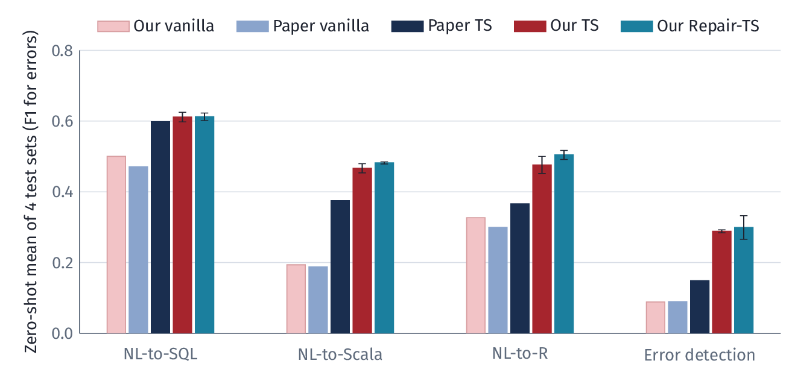
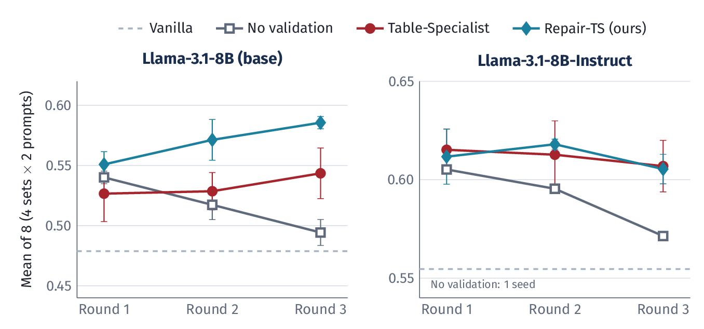
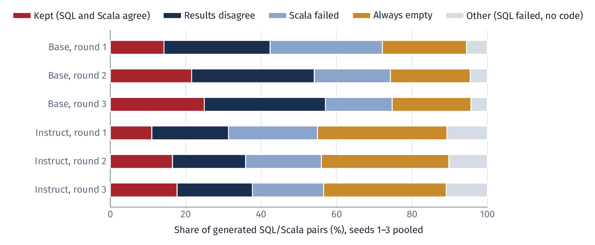
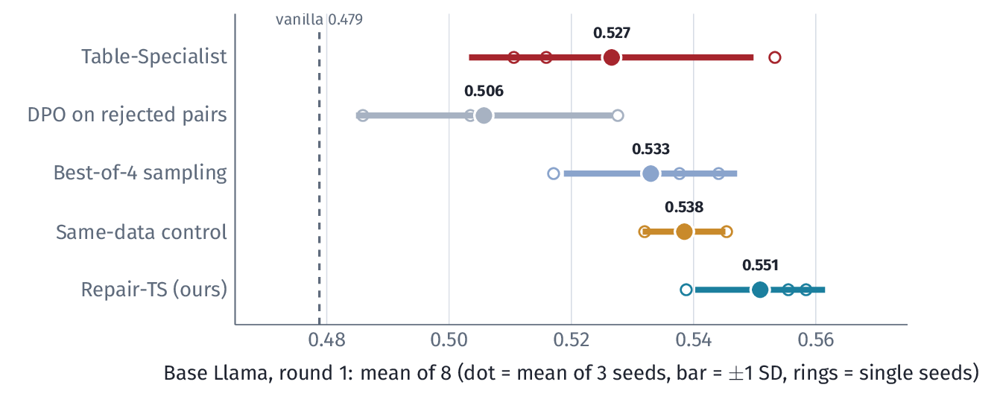
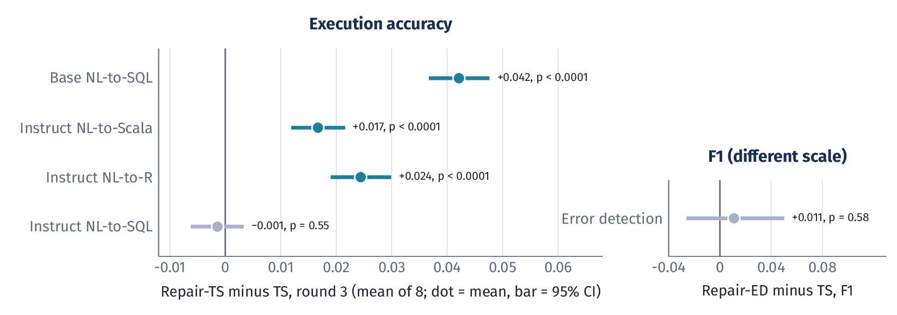

# Reproducing and Extending Table-LLM-Specialist (EMNLP 2025)

[](https://arxiv.org/abs/2410.12164)
[](https://arxiv.org/abs/2410.12164)
[](https://huggingface.co/meta-llama/Llama-3.1-8B-Instruct)
[](configs/requirements.lock)
[](report/main.pdf)
[](presentation/endsem.pdf)
[](LICENSE)

A reproduction of **Table-LLM-Specialist** (Xing et al., EMNLP 2025) for **Llama-3.1-8B**, run on one workstation as
a course project at IIT Jammu, and an extension, **Repair-TS**, that recovers some of the training data the paper's
validator throws away.

Table-Specialist fine-tunes a language model for a table task **without human labels**. It pairs each task with a
*dual* task that can check it: for NL-to-SQL, a SQL program and a Spark-Scala program written for the same question
must return the same rows on random samples of the table. Only agreeing pairs become training data. The fine-tuned
model then writes the next round's data, for three rounds.

We asked two questions:

1. **Does it reproduce?** Can we match the paper's Llama-3.1-8B numbers from what is published?
2. **Can it be improved?** The validator keeps only **11–25%** of the pairs it sees. Can the rest be used?

## Findings

- **The paper reproduces, but on Instruct, not the base checkpoint the repository's README points to.** Base
  Llama-3.1-8B misses the paper's vanilla scores under every setting we tried (WikiSQL 0.326 against 0.525).
  Llama-3.1-8B-Instruct, queried through the repository's own chat call, lands within 0.015 on three of four test sets.
  After three rounds its zero-shot mean of four is **0.611 ± 0.014 against the paper's 0.598**.
- **All four tasks beat vanilla, and three land above the paper's figures.** NL-to-Scala 0.467 (paper 0.375),
  NL-to-R 0.476 (paper 0.366), error detection F1 0.288 (paper 0.148), all from vanilla scores that match the paper.
- **Validation pays off only over rounds.** Training on unvalidated data wins in round 1 (6.6× more data), then falls
  every round. By round 3, Table-Specialist leads it by **+0.049** and vanilla by **+0.065** (p < 0.0001, every seed).
- **Learning from rejected programs with DPO hurts** (−0.021, p < 0.0001), even after tuning on dev sets.
- **Repairing rejected pairs helps where first-pass data is weak.** One execution-guided repair per rejected pair,
  re-checked by the paper's unchanged validator, gains **+0.042** on base NL-to-SQL, **+0.017** on NL-to-Scala and
  **+0.024** on NL-to-R at round 3 (all p < 0.0001, every seed). It does nothing on Instruct NL-to-SQL (−0.001,
  p = 0.55), where the first-pass data is already strong.

## How it works, and where Repair-TS fits



The paper's loop is everything outside the two teal boxes. Repair-TS adds them: a rejected pair gets **one** repair,
guided only by what its own program did (an error message, "returns no rows", or its own result). A program never sees
the other language's code or output, so agreement after repair is still two independent programs agreeing.

The same idea extends to the paper's other tasks:

| Task | Generated | Dual task that checks it | Metric |
|---|---|---|---|
| NL-to-SQL | SQL | Spark-Scala for the same question | Execution accuracy |
| NL-to-Scala | Spark-Scala | SQL (trained inside the same loop) | Execution accuracy |
| NL-to-R | R | SQL; our validator, since the repository has none | Execution accuracy |
| Error detection | Find the injected error in a column | Inject a typo or semantic error, check it is found | F1 |

## Results

All charts are generated from the result files by [`scripts/make_readme_figures.py`](scripts/make_readme_figures.py);
no number in them is typed by hand. Paper figures come from the published Table 3 (Llama-3.1-8B). Our numbers are the
mean ± standard deviation over seeds 1–3, round 3, unless stated otherwise.

### 1. NL-to-SQL: Instruct matches the paper

<p align="center"></p>

| Test set | Our vanilla | Paper vanilla | Our Table-Specialist | Paper Table-Specialist |
|---|---|---|---|---|
| WikiSQL | 0.518 | 0.525 | 0.784 ± 0.031 | 0.816 |
| WikiTQ | 0.289 | 0.300 | 0.423 ± 0.002 | 0.449 |
| Spider | 0.791 | 0.670 | 0.806 ± 0.008 | 0.690 |
| BIRD | 0.402 | 0.388 | 0.432 ± 0.021 | 0.438 |
| **Mean of 4** | **0.500** | **0.471** | **0.611 ± 0.014** | **0.598** |

Zero-shot, Llama-3.1-8B-Instruct. Spider is the one outlier: every model of ours, vanilla included, scores 0.06–0.12
above the paper there, so it is an offset in the test set, not a training effect. Text2Analysis, the paper's fifth test
set, is not public.

### 2. All four tasks

<p align="center"></p>

| Task | Our vanilla | Paper vanilla | Paper TS | Our TS | Our Repair-TS |
|---|---|---|---|---|---|
| NL-to-SQL | 0.500 | 0.471 | 0.598 | 0.611 ± 0.014 | 0.612 ± 0.011 |
| NL-to-Scala | 0.194 | 0.188 | 0.375 | 0.467 ± 0.013 | **0.482 ± 0.003** |
| NL-to-R | 0.327 | 0.299 | 0.366 | 0.476 ± 0.024 | **0.504 ± 0.013** |
| Error detection (F1) | 0.089 | 0.090 | 0.148 | 0.288 ± 0.004 | 0.299 ± 0.034 |

Execution accuracy is the zero-shot mean of the four public test sets; error detection is the mean F1 of the ST and RT
test sets. Vanilla matches the paper on every task, so the gaps above the paper come from training. We cannot say which
of our choices causes them: corpus, checkpoint and round choice are all candidates.

### 3. Validation only pays off over rounds

<p align="center"></p>

The mean of 8 averages four test sets × two prompts (zero-shot and few-shot). On base Llama, training **without**
validation wins round 1, because it trains on 6.6× more pairs. Then it falls every round as its own errors compound.
Table-Specialist climbs instead and leads by **+0.049** at round 3 (paired bootstrap, p < 0.0001, all three seeds).
The paper does not show this round-1 crossover. Repair-TS (teal) is ahead of Table-Specialist at every round on base.

### 4. The waste: what the validator throws away

<p align="center"></p>

Of about 8,700–8,900 generated pairs per round (three seeds pooled), only **11–25%** survive. Most rejections are
recoverable failures: a Scala program that does not compile, a query that returns no rows, or two programs that almost
agree. That is the motivation for repair.

### 5. Recovering rejected data: what worked and what did not

<p align="center"></p>

We tried three ways to use more of the generated data, all at round 1 on base Llama:

| Idea | What it does | Result vs. Table-Specialist (mean of 8) |
|---|---|---|
| **DPO on rejected pairs** | Validated program = chosen, rejected program = negative | **−0.021**, p < 0.0001; still negative after tuning on dev sets |
| **Best-of-4 sampling** | Sample 4 candidates per question, keep the first that validates | Small gain (+0.006), unstable across seeds |
| **Repair-TS** | Repair each rejected pair once, re-validate unchanged | **+0.024**, p < 0.0001 at round 1, growing to +0.042 by round 3 |

The lesson from DPO: a validator is good at *selecting* data, but its rejects are poor negatives. Many rejected programs
are nearly right, so pushing the model away from them hurts.

#### Repair-TS at round 3, across every setting

<p align="center"></p>

| Setting | Repair − TS (round 3) | 95% CI | p | Per seed |
|---|---|---|---|---|
| Base NL-to-SQL | **+0.042** | [+0.037, +0.048] | < 0.0001 | +0.020, +0.056, +0.050 |
| Instruct NL-to-Scala | **+0.017** | [+0.012, +0.022] | < 0.0001 | +0.009, +0.024, +0.017 |
| Instruct NL-to-R | **+0.024** | [+0.019, +0.030] | < 0.0001 | +0.014, +0.036, +0.023 |
| Instruct NL-to-SQL | −0.001 | [−0.006, +0.003] | 0.55 | −0.004, +0.005, −0.005 |
| Error detection (F1) | +0.011 | [−0.026, +0.050] | 0.58 | −0.032, +0.028, +0.037 |

Paired bootstrap over test cases (over columns for error detection), 10,000 draws. On error detection, repair helps
significantly only at round 1 (+0.027 F1, p = 0.03).

#### Is it just more data?

Repair adds training pairs, so we ran **same-data controls**: plain Table-Specialist given the same number of extra
pairs, drawn fresh from new tables instead of repaired.

| Setting (round 1) | Control − TS | Repair − control | Reading |
|---|---|---|---|
| Base NL-to-SQL | +0.012 (p < 0.0001) | **+0.012** (p < 0.0001, every seed) | About half the gain is data volume, half is repair |
| Instruct NL-to-SQL | +0.008 (p = 0.0006) | −0.011 (p < 0.0001) | Extra fresh pairs help; repaired pairs are worth less |
| Error detection | +0.004 (p = 0.69) | +0.023 (p = 0.03) | Beats the control, but not a plain second sample (best-of-2: +0.006, p = 0.71) |

No same-data control was run for NL-to-R. On base, the repairer is the Instruct model, so part of the base gain may be
distillation from a stronger model.

## What the paper and repository leave out, and what we did

| Gap | What we did |
|---|---|
| Training corpus not released | Built a filtered, de-duplicated corpus of **10,053 GitTables tables**, with a header-overlap contamination check |
| Text2Analysis and the test-case lists not released | Rebuilt WikiSQL, WikiTQ, Spider and BIRD test sets from the original datasets; Text2Analysis left out |
| Checkpoint (base or Instruct) not stated; README links base | Ran both. Base fails the vanilla check under every setting; Instruct matches it |
| Test prompt and reported round not stated | Report zero-shot as the headline, few-shot alongside, and every round |
| LoRA settings not stated | Our own choices, recorded in [`configs/base.yaml`](configs/base.yaml) |
| **The validator never compares SQL with Scala output** | Wrote the comparator ([`ts/validate/exec_agree.py`](ts/validate/exec_agree.py)) and audited it by hand |
| The repository's result comparison has three defects | Report repo-faithful scores (defects kept) and corrected scores ([`ts/eval/compare.py`](ts/eval/compare.py)) side by side |
| No NL-to-R validator | Wrote one, with SQL as the dual task ([`ts/validate/r_agree.py`](ts/validate/r_agree.py)) |

## Approach

| Component | What it does | Code |
|---|---|---|
| Corpus | GitTables filtering, de-duplication, contamination check, manifest | `ts/corpus/build.py` |
| Test sets | Rebuild WikiSQL, WikiTQ, Spider and BIRD as the repository's `data.csv` + `info.json` | `ts/bench/` |
| LLM client | vLLM client with retries and a response cache | `ts/llm/client.py` |
| Generation | Questions, SQL, Scala and R with the repository's prompts | `ts/gen/` |
| Validation | Paper Algorithm 3: 10 half-samples, both programs must agree on all of them | `ts/validate/` |
| Training | LoRA fine-tuning (SFT), plus DPO for the preference-learning test | `ts/train/` |
| Main loop | Rounds, arms (Table-Specialist, no validation), checkpoints and resume | `ts/loop.py` |
| Repair-TS | One execution-guided repair per rejected pair, then re-validation | `ts/repair.py`, `ts/repair_loop.py` |
| Other tasks | NL-to-R loop, error-detection loop, Scala evaluation | `ts/r_loop.py`, `ts/ed_loop.py`, `ts/eval/` |
| Controls | Same-data control, best-of-N, self-consistency voting | `ts/data_control.py`, `ts/ext2.py`, `ts/eval/self_consistency.py` |
| Statistics | Paired bootstrap over test cases, per-seed signs | `ts/analysis/` |

### Design decisions

- **Report every seed's sign, not only a p-value.** The bootstrap resamples test cases, not seeds, so it does not cover
  seed variance. A result counts as clear only if it is significant *and* positive on every seed.
- **Repo-faithful scores are the headline.** They keep the repository's comparison defects so they compare with the
  paper. Corrected scores are reported next to them.
- **Repair is checked by the paper's unchanged validator.** Repair can only add pairs that pass the same test as
  first-pass pairs, and a program never sees the other language's output.
- **The go/no-go rule for repair was fixed before the pilot.** Base as its own repairer recovered too little (+17%), so
  it was dropped. Instruct as repairer recovered +56%, and a hand check found 21 of 23 recovered pairs correct.
- **Generated code never runs on the host.** Model-written Scala and R run only in Docker sandboxes with pinned image
  digests ([`configs/sandbox.env`](configs/sandbox.env)). Model-written SQL runs read-only, SELECT only, with a 5-second
  limit.
- **Everything resumes.** Each finished step is skipped on restart. The study survived a machine crash, a 7.5-hour stall
  and a WSL crash without losing a result.

### Limitations

- **Unreleased data.** Our corpus and rebuilt test sets differ from the paper's, so absolute scores are not exactly
  comparable, and averages cover 4 of the paper's 5 test sets.
- **Three seeds per arm** (one for Instruct no-validation). Effects below about 0.01 cannot be ranked reliably.
- **Our comparator decides which pairs are kept.** It was audited by hand (39 of 50 kept pairs fit their question), but
  not against labelled data.
- **Small error-detection test sets**: 42 and 36 columns with errors. One column moves F1 by 0.01–0.02.
- **Missing controls**: no same-data control for NL-to-R, and the error-detection controls cover round 1 only.
- **Confounded repairer on base**: the repairs are written by a stronger model, so base Repair-TS is not pure
  self-training.

**Claims we do not make:** that the paper used Instruct (supported, not proven); that repair helps self-trained
specialists in general (it is null on Instruct NL-to-SQL); or that the paper under-reports Scala, R or error detection
(the difference is unattributed).

## Reproduce

**Hardware used:** 2 × NVIDIA RTX 4500 Ada (24 GB each), Ubuntu 24.04 under WSL2, Docker. One job runs per GPU: vLLM
serves the model on the same GPU that trains. The full command sequence, in the order it was run, is in Appendix H of
the report ([`report/appendices/H-reproduce.tex`](report/appendices/H-reproduce.tex)).

```bash
git clone --recurse-submodules https://github.com/tajammulbasheer/table_specialist_repair.git
cd table_specialist_repair
python3.12 -m venv .venv && .venv/bin/pip install -r configs/requirements.lock

scripts/download_data.sh                  # benchmarks + GitTables (only downloads; nothing is executed)
# Build the Python, Spark and R sandboxes; their image digests are pinned in configs/sandbox.env
```

Llama-3.1-8B and Llama-3.1-8B-Instruct are gated on Hugging Face: accept the licence and log in before the first run.

```bash
# Core study: one arm per GPU, 3 seeds x 3 rounds x 3,000 tables. Safe to re-run: finished steps are skipped.
scripts/run_study.sh table_specialist 0 8000
scripts/run_study.sh no_validation   1 8001

# Extensions and other tasks (each prints its options with --help)
.venv/bin/python -m ts.repair_loop --help    # Repair-TS
.venv/bin/python -m ts.r_loop --help         # NL-to-R
.venv/bin/python -m ts.ed_loop --help        # error detection
.venv/bin/python -m ts.ext2 --help           # DPO and best-of-4

# Analysis, report and figures
.venv/bin/python -m ts.analysis.significance
.venv/bin/python report/tools/build_tables.py && report/build.sh
scripts/build_readme_figures.sh              # regenerates assets/*.png
.venv/bin/python -m pytest tests
```

Every setting the paper does not publish is our own choice and is recorded in [`configs/`](configs/), with the
reasoning in [`docs/DECISIONS.md`](docs/DECISIONS.md).

## Repository structure

```
ts/
  corpus/            training-table corpus: filter, de-duplicate, contamination check
  bench/             rebuild WikiSQL, WikiTQ, Spider and BIRD test sets
  llm/               vLLM client with retries and a response cache
  gen/               question, SQL, Scala and R generation (the repository's prompts)
  validate/          execution agreement: SQL vs Scala (Algorithm 3), SQL vs R
  train/             LoRA SFT and DPO
  eval/              repo evaluators, corrected comparator, Scala/R/error-detection scoring, voting
  analysis/          results tables and paired-bootstrap significance tests
  loop.py            Table-Specialist and no-validation rounds, checkpoint and resume
  repair*.py         Repair-TS and repair for error detection
  r_loop.py          NL-to-R loop      ed_loop.py   error-detection loop
  ext2*.py           DPO and best-of-4 experiments
configs/             run settings, pinned requirements, sandbox image digests
scripts/             setup, study runners, figure builders
tests/               pytest suite
results/             per-cell result files, test-case ID lists, significance tables
report/              LaTeX report (main.pdf), table generator
presentation/        Beamer slides (endsem.pdf) and speaker transcript (transcript.pdf)
docs/                task log, decisions, full results log
assets/              README charts and their pgfplots sources
third_party/         microsoft/Table-Specialist (git submodule)
```

Data, model weights, run directories and logs are not in the repository.

## Documents

- **[Report](report/main.pdf)**: the full study, with every table generated from the result files.
- **[Slides](presentation/endsem.pdf)**: the end-semester presentation.
- **[Results log](docs/RESULTS.md)** and **[decisions](docs/DECISIONS.md)**: the dated record of what was run and why.

## Credits

- **Paper:** J. Xing, Y. He, M. Zhou, H. Dong, S. Han, D. Zhang, S. Chaudhuri. *Table-LLM-Specialist: Language Model
  Specialists for Tables using Iterative Generator-Validator Fine-tuning.* EMNLP 2025, pp. 35443–35460.
  [arXiv:2410.12164](https://arxiv.org/abs/2410.12164).
- **Code:** [microsoft/Table-Specialist](https://github.com/microsoft/Table-Specialist), pinned as a submodule.
- **Data:** [GitTables](https://gittables.github.io/) (training tables), [WikiSQL](https://github.com/salesforce/WikiSQL),
  [WikiTableQuestions](https://github.com/ppasupat/WikiTableQuestions), [Spider](https://yale-lily.github.io/spider),
  [BIRD](https://bird-bench.github.io/), and [AutoTest](https://github.com/qixuchen/AutoTest) (error-detection test sets).
  Datasets are downloaded at run time and are not redistributed here.
- **Model:** [Llama-3.1-8B and Llama-3.1-8B-Instruct](https://huggingface.co/meta-llama), Meta.

**Authors:** Fadil Mir and Tajamul Bashir, IIT Jammu.

## License

MIT for the code in this repository. See [LICENSE](LICENSE). `third_party/Table-Specialist` keeps its own license.
